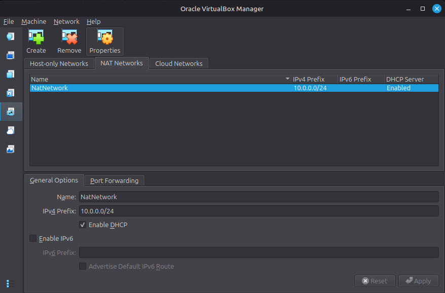
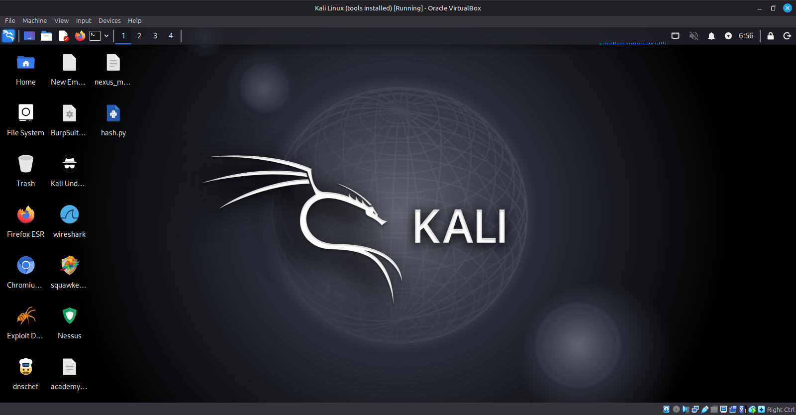
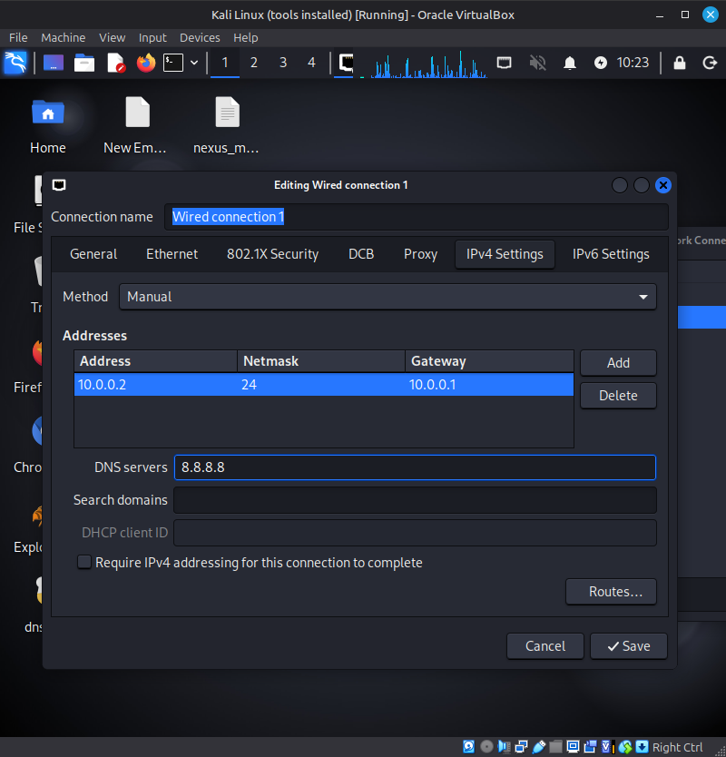

# Cybersecurity Lab Setup: VirtualBox + Kali Linux

A small, isolated lab for practicing penetration testing. Kali Linux runs in VirtualBox on a private NAT Network, with room to add target machines later.

> Use this lab only on systems you own or have explicit permission to test.

## Goals

- Install VirtualBox and import Kali Linux
- Create a private NAT Network
- Give Kali a static IP and confirm connectivity and DNS
- Save a clean snapshot to roll back to


## Configuration

| Component       | Value                |
| --------------- | -------------------- |
| Host OS         | Windows 10           |
| Host hardware   | Intel Core i5, 16 GB RAM |
| Hypervisor      | VirtualBox 7.2       |
| Guest OS        | Kali Linux 2026.2    |
| Guest RAM       | 2048 MB              |
| Network         | NAT Network, 10.0.0.0/24 |
| Kali IP         | 10.0.0.2/24          |
| Gateway         | 10.0.0.1             |
| DNS             | 8.8.8.8              |
| Reserved for VMs | 10.0.0.3 - 10.0.0.99 |

## Setup

**1. Install 7-Zip and VirtualBox.** 7-Zip is needed to unpack the Kali VM, which is often shipped as a `.7z` archive.

**2. Create the NAT Network** in VirtualBox:

```text
Name:  NatNetwork
CIDR:  10.0.0.0/24
DHCP:  enabled
IPv6:  disabled
```



A NAT Network lets VMs talk to each other and still reach the internet, which is what a multi-VM lab needs.

**3. Import Kali Linux** from the official Kali site, then set Adapter 1 to NAT Network (`NatNetwork`, Intel PRO/1000 MT Desktop) and give the VM 4096 MB of RAM. A shared folder was added for moving files between host and VM.



**4. Set a static IP** in Kali:

```text
IP:      10.0.0.2
Netmask: 255.255.255.0
Gateway: 10.0.0.1
DNS:     8.8.8.8
```



**5. Take a snapshot** (for example, "Clean Kali - Network Setup") so the lab can be restored if an experiment breaks something.

## Verification

| Check            | Command                     | Expect                    |
| ---------------- | --------------------------- | ------------------------- |
| IP address       | `ip a`                      | 10.0.0.2/24               |
| Gateway          | `ping 10.0.0.1`             | Replies                   |
| Internet         | `ping 8.8.8.8`              | Replies                   |
| DNS              | `nslookup networkwalks.com` | Resolves                  |
| Nmap installed   | `nmap --version`            | Version printed           |
| Snapshot restore | Restore, then `ip a`        | Baseline config returns   |

## Troubleshooting

**No internet after setting a static IP.** Disabling the duplicate-address-detection delay fixed it here:

```bash
sudo nmcli connection modify "Wired connection 1" ipv4.dad-timeout 0
```

Restart the connection (or reboot) and test again. Your connection name may differ, so check it first with `nmcli connection show`.

**VirtualBox VT-x error on startup.** Hardware virtualization was off in the BIOS/UEFI. Enable Intel VT-x, save, reboot, and start the VM again.

## Takeaways

- A NAT Network suits multi-VM labs better than plain NAT because the VMs can reach each other.
- Static addressing (IP, mask, gateway, DNS) makes the lab easier to document and reuse.
- Snapshot before risky experiments, not after.
- Writing down commands, problems, and fixes is part of the job.

## Resources

- [7-Zip](https://7-zip.org/download.html)
- [VirtualBox](https://virtualbox.org/wiki/Downloads)
- [Kali Linux](https://kali.org/get-kali)


